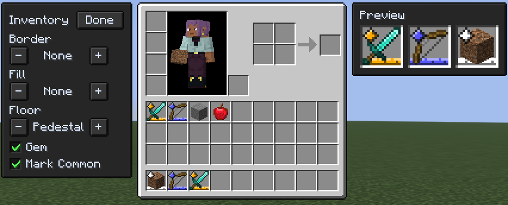

# ds-mod (beta)

A client-side mod for [Dragon Simulator](https://dragsim.co). Open source, built on Fabric.

I want to bring the popular features from Hypixel SkyBlock mods to Dragon Simulator. Suggestions and contributions are welcome in the [Discord](https://discord.gg/YUZCYAnr7F) or as a [GitHub issue](https://github.com/noxaur/ds-mod/issues). If you can't contribute code, you can support the mod on [Ko-fi](https://ko-fi.com/noxaur).

## Features

- Zealot Tracker counts your eyes, eyes per hour and kills per eye, for the session and all-time.
- Boss Beacon puts a beam where the next Endstone Protector will emerge, as soon as the last one dies.
- Dragon Timer and Golem Status show the egg countdown, the eyes placed and the Protector's stage.
- Boss Drops keeps your placement, damage and loot from every dragon and Protector fight.
- Slayer Tracker shows your quest progress, the XP to your next level and your average kill time.
- Loot Alerts go off for drops at or above the rarity you set.
- Rarity Marks color each slot by its item's rarity. Pick Showcase, Gilded or Minimal, or build your own look beside your inventory.

  
  

It also has a HUD editor, Fullbright, and guards against two misclicks: taking a placed eye back out of the altar, and swapping armor with a right click.

Toggle any feature in `/dsmod`. The [feature guide](docs/user/features.md) has the full list.

## Install

Download the jar from [Releases](https://github.com/noxaur/ds-mod/releases) and put it in your `mods` folder with [Fabric API](https://modrinth.com/mod/fabric-api) and [Fabric Language Kotlin](https://modrinth.com/mod/fabric-language-kotlin). The [install guide](docs/user/install.md) lists the versions.

## Goals

- A beta goes out every second day when there is something new, so a server update or a suggestion from the Discord doesn't wait months.
- The mod draws its own settings screen and HUD. You can pick a dark theme or one that matches vanilla menus.
- It only displays information. It has no macros and nothing that plays for you, because the server bans them.

## Contributing

Suggest features in the [Discord](https://discord.gg/YUZCYAnr7F) and report bugs in [issues](https://github.com/noxaur/ds-mod/issues). I haven't reached the late game, so recordings of it help the most.

Reviewing a pull request costs me more time than writing one costs you. Before you open one:

- Read [CONTRIBUTING.md](CONTRIBUTING.md) and run the checks.
- Test the feature in game yourself, and say what you saw.
- I recommend using the most capable model you have access to, and reviewing its work with a capable model from another lab (e.g. Opus 5.5 writes the code, Sol 6.1 verifies it).

A pull request that skips those takes longer to review than the fix would take me to write.

Made by [noxaur](https://github.com/noxaur). Not affiliated with the Dragon Simulator team. Licensed under [Apache 2.0](LICENSE).
