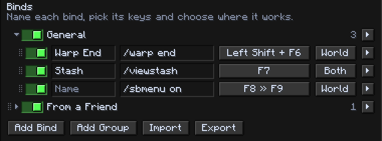
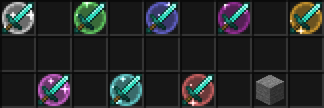
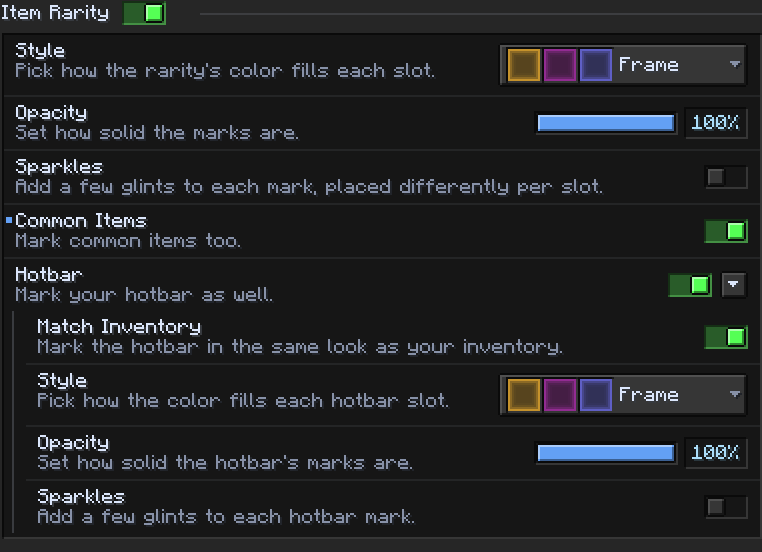

# Features

`/dsmod` opens the settings. Everything is on unless marked off.

<sub>Trackers read only the server's own messages, never player chat. All-time numbers are kept for each of your profiles, in `config/dsmod/data/players/`, one file for each Minecraft account. Delete that file to reset them, along with everything else ds-mod remembers of your profiles.</sub>

## General

### DragSim Only

ds-mod runs only while you play on dragsim.co, and stays out of the way in singleplayer and on other servers. Turn it off to use ds-mod anywhere. Features that read the server read dragsim.co's own lines, so elsewhere they can miss or miscount.

### Ctrl Click

On a Mac, Minecraft turns Ctrl and a left click into a right click. ds-mod keeps it a Ctrl click, as on Windows and Linux, so a Ctrl click opens a section in a new tab and works in menus the same way. Turn it off to get the Mac's right click back.

<sub>Only a Mac shows it.</sub>

### Fullbright

Lights caves and nights as brightly as day.

<sub>Off by default.</sub>

### Hide Explosions

Hides the clouds that explosions throw up.

<sub>Off by default.</sub>

### Animations

Changes how your held item swings and where it sits in first person, and lets a sword block on right click as in 1.7. Each setting starts at the game's own, so nothing changes until you move one. Only you see it: your clicks and the swing other players see stay the same.

**Preview** at the top shows your item with the settings below on it. **Held** shows it at rest, **Swinging** swings it in a loop, and **Screen view** shows where it sits on a template screen. The screen view shows as much of the screen as the item needs, and runs past the screen's edge when the item does, so you can see what goes off screen. Press a view, or use Left and Right. It shows the item in your main hand, or a sword while your hand is empty.

**Style** makes your item act like a game version or an item, and the other settings tune it from there:

| Style | Does |
| --- | --- |
| 1.7 | Holds flat items such as swords the 1.7 way, a little smaller and turned, with no dip after a hit, and swings while you block |
| Modern | The game today. After each hit the item dips out of view while the attack recharges |
| Stab | Holds, swings and lowers every item as a spear |

Open **Swing** for:

| Setting | Does |
| --- | --- |
| Speed | Speeds your swing up to 3 times, or slows it down to a tenth, in first person. In third person your arm swings at the game's own pace |
| Turn | How far the item pivots about its grip in a swing, from 0% to the game's 100% |
| Reach | How far the item moves toward the middle of the screen in a swing. At 0% the grip stays put and the item only pivots |
| Scale Swing | Makes the swing reach as far as Size makes the item big. On by default |
| No Swing | Keeps the item still when you swing |
| No Bow Swing | Keeps a bow or crossbow still when you swing it, for a bow that shoots on a click |
| Ignore Haste | Keeps the swing at the same pace under Haste or Mining Fatigue |

Open **Held Item** for:

| Setting | Does |
| --- | --- |
| Size | Grows the item to twice its size, or shrinks it to a tenth |
| X, Y, Z | Moves the item across, up and away, far enough to put it anywhere on the screen. Your off hand mirrors X |
| Yaw, Pitch, Roll | Turns the item about its grip. Your off hand mirrors Yaw and Roll |
| Flip | Mirrors the item in your hand, so it points the other way and stays where it is. Blocks flip too. To hold it on the left of the screen, use the game's own Main Hand setting |
| No Equip Reset | Keeps the item up after a hit or a use, and when the server updates it, instead of lowering and raising it, under any style |

Open **Right Click** for **1.7 Blocking**: hold right click with a sword to raise it across the screen, as 1.7 did. Only swords block, and a spear never did, so Stab doesn't. Under 1.7 your swings keep going while you block, and under Modern the sword holds still as in 1.8. Your arm comes up in third person too. It only changes what you see, so right click still does whatever the server gives it, such as a sword's ability.

**Reset** beside Reset Animations puts every setting back to the game's own. Your empty hand and maps keep the game's own pose.

### Player Model

Resizes, tilts, spins and poses your player in third person and in your inventory, as Odin's Player Size does. Only you see it: your hitbox, your camera and what other players see stay the same, and first person is untouched. Each setting starts at the game's own.

| Setting | Does |
| --- | --- |
| Players | Changes only your own model, or every player's, mannequins included |
| Size | Grows the model up to three times its size, or shrinks it to a tenth |
| Tilt Forward | Leans the model forward from its feet, or back below zero |
| Tilt Sideways | Leans the model to its right from its feet, or left below zero |
| Upside Down | Stands the model on its head |
| Spin | Spins the model up to five turns a second, the other way below zero. It turns at the same pace whichever way you walk or look, and the head turns with it |
| Pose | Holds the arms and legs still in a T-Pose, Star, Arms Up, Zombie, Dab or Sit, while the head follows where you look. Armor and held items follow the limbs |

**Preview**, at the top of the settings, shows your player with every setting on while you are in a world. Drag it to turn it around and tip it, or press Left and Right with the row picked. Open **Stretch** to make the model wider, taller or deeper than its size. The settings combine: a T-Pose with a spin, or Tilt Forward at 90 with Arms Up. **Reset** beside Reset Model puts every setting but Players back to the game's own.

<sub>Off by default.</sub>

### Ability Cooldowns

```
Ability Cooldowns
Giant's Slam: 3.2s
Void Infusion: 1m 12s
Between Worlds: Ready
```

Times every item ability you use, such as Giant's Slam, the Tuba's Howl, a katana's Soulcry and your drill's ability, and the 8 seconds Riftwalker armor needs between two blinking hits. The item's slot drains a white wash as the wait runs out, as an ender pearl's does, with the seconds left where its count goes, on your hotbar and in every menu. A ready ability shows Ready on the list for two seconds.

| Setting | Does |
| --- | --- |
| List | Lists the abilities you are waiting on, on the HUD. Move it in the HUD editor |
| On Items | Drains the wash over the item and counts down its seconds |
| Shortest Listed | Leaves cooldowns shorter than this off the list, so a weapon you click every second does not flicker there. Their items still show the wash |
| Ready Alert | Shows a title with a sound when a cooldown is over. Off by default |
| Alert From | Alerts only for cooldowns at least this long, 20 seconds by default, so the Tuba and the drill alert and Giant's Slam does not |

<sub>The length comes from the item's own lore, so carry the item. If you press too early, the server says how long is left, and the timer follows it, even when a buff makes the cooldown shorter than the lore says.</sub>

### Equipment Display

Shows the armor you wear and your pet as a row of icons on the HUD, with each head's skin and each leather piece's dye. Your pet's head joins the row once you open the Pets menu or it floats near you, and until then the pet shows as its name under the row. Open the chat and point at a piece to read its tooltip. The pet's tooltip from the Pets menu names its held item. A dungeon's sidebar names no pet, so there the row keeps the pet you had out.

| Setting | Does |
| --- | --- |
| Equipment Pieces | Picks which pieces show, and their order. Drag a piece to move it, take it out with − or the bin, and bring it back with + |
| Equipment Layout | Lines the pieces up in a row or a column |
| Pet Look | Shows your pet as its head among the armor, or as its name and level in the color of its rarity, with its held item once you opened the Pets menu |
| Pet Position | Puts your pet among the armor, in the order of Equipment Pieces, or on a row of its own above or below it |
| Equipment Look | Shows the pieces on the HUD's plate, on nothing, or in slots like your hotbar's, which follow your resource pack |
| Equipment Placement | Keeps the pieces where you put them in the HUD editor, or puts them beside your hotbar, at its size and past your offhand slot. Dragging the pieces out of that spot or into it sets this for you |

### Active Pet

Shows the pet you have out on the HUD: its head, its name and level in the color of its rarity, the pet item it holds, how far it is to its next level, how much XP it gains an hour, and how long until it levels up. It is off until you turn it on. The name and level follow the sidebar, so they change the moment you summon another pet or it levels up, and the block goes when the sidebar says Pet: None. A dungeon's sidebar names no pet, so there the block follows chat, Autopet and the Pets menu: a summon in chat or the menu switches it, and despawning in the menu takes it away.

Open the Pets menu once to fill in the rest. The head and the held item are kept for each pet after that, even across restarts, and change when chat says you gave your pet another item. Until then the head is that of your pet floating beside you. Open the chat and point at the head to read its tooltip.

The XP is read each time you open the Pets menu. Open it again a little later, at the same level, and the block shows your XP per hour and the time to the next level, which counts down. With a combat pet, the XP then moves with each kill, and each time you open the menu it is set right again. Summoning another pet or a level up starts the rate over.

| Setting | Does |
| --- | --- |
| Icon | Shows your pet's head beside its name |
| Held Item | Shows the pet item your pet holds |
| XP | Shows how far your pet is to its next level, as a bar |
| XP Rate | Shows how much XP your pet gains an hour, from two reads of the Pets menu |
| Next Level | Shows how long until your pet reaches its next level at that rate |
| Hide Autopet | Hides the chat line Autopet sends when it swaps your pet. Off until you turn it on |

### Inventory HUD

Shows the items in your inventory as a grid on the HUD, nine to a row as your inventory holds them, with each stack's count, durability bar and cooldown. Item Rarity colors each slot as it does in your inventory, and with your hotbar in the grid the slot you hold is ringed. The grid steps aside while a menu or your inventory is open, since they show your items already. Open the chat and point at an item to read its tooltip, and move or resize the grid in the HUD editor. Turn it on in General.

| Setting | Does |
| --- | --- |
| Inventory Rows | Picks which rows show, and their order. The three rows of your inventory show by default, and your hotbar, your armor and your offhand can join them, each set a little apart as your hotbar is in your inventory |
| Inventory Look | Draws the grid in a panel of slots like your inventory's: in your theme, solid or as glass as Menu Look says, while Menu Theme is on, and as your resource pack draws the inventory while it is off. Plate and Clear show the items alone, on the HUD's plate or on nothing |
| Inventory Placement | Keeps the grid where you put it in the HUD editor, or puts it beside your hotbar, past your offhand slot, at your GUI's size or smaller where the room there is narrower |
| Inventory Key | Binds a key that shows and hides the grid. With none, the grid always shows |
| Inventory Key Mode | Shows the grid only while you hold the key, or switches it with each press |
| Inventory Layout | Lays each row out across, as your inventory does, or down, so the grid stands tall beside the edge of your screen |
| Inventory Opacity | Sets how solid the Inventory look's panel and slots are, so the world shows through as much as you like |
| Pickup Animation | Bobs an item in the grid as it lands in your inventory, as your hotbar does |

### Performance Stats

Shows your frames per second, your ping and the server's ticks per second on the HUD. Turn it on under Interface in `/dsmod`, and place it in the HUD editor or by dragging it with the chat open, like any other block.

- **FPS** is the game's own count of the frames it drew in the last second.
- **Ping** is how long the server takes to answer, there and back, as the mean of its last five answers. The tab list always says 0 on Dragon Simulator, so the mod asks the server once a second while Ping is shown, the same way the F3 network chart does. Take Ping out of the values and the mod stops asking.
- **TPS** is how many ticks the server ran each second over the last ten seconds, read from the clock it sends. 20 is full speed. If the server stops sending its clock for a few seconds, the value falls for as long as it stays quiet.

Each value shows `-` until it has something to show: TPS needs about two seconds, and starts again when you change lobbies. Ping turns yellow above 150 ms and red above 300 ms. TPS turns yellow below 18 and red below 12.

| Setting | Does |
| --- | --- |
| Values | Picks which of FPS, Ping and TPS show, and their order |
| Layout | Lines the values up in a row or a column |
| Look | Shows the values on the HUD's plate, or on nothing |

### Etherwarp Outline

While you sneak with an Aspect of the End or Aspect of the Void that has Etherwarp, a green box sits on the block a sneak right click would warp you to. It reads the range from the item's lore, so a blade with a longer reach gets its own. A red box means the warp would fail there, and says why: Too Far for a block past the range, or No Room when the two blocks above it are not clear. No box means nothing on your look line can be warped to. Water, lava, grass, flowers and torches don't stop the line, so you warp through them, and a slab is boxed as the half block it is. It only shows you where you'd land, and never warps for you.

| Setting | Does |
| --- | --- |
| Etherwarp Style | Draws the box as its edges, as a tinted fill, or both |
| Etherwarp Width | Sets how thick the edges are |
| Failed Warps | Shows the red box with its reason. Turn it off to see a box only where the warp works |
| Box Through Walls | Shows the whole box, even behind the blocks in front of it. Turn it off to let blocks hide it |
| Box Without Sneak | Shows the box while you stand too, from where your eye will be once you sneak. Off by default |

### Auto Click

Clicks 9.9 times a second while you hold a key and walk. It stops the moment you let go, stand still or open a menu, and each click goes through the game as your own would. It has a part for each button, and both start on once you turn Auto Click on.

| Setting | Does |
| --- | --- |
| Left Click | Left clicks while its key is down |
| Right Click | Right clicks while its key is down, such as to keep using a sword's ability as you run |
| Key | Any key or mouse button. Left Click starts on the left mouse button and Right Click on the right, and the two can't share a key |
| Mode | Hold, or Toggle to press once to start and again to stop. A toggled click still runs only while you walk |

Your own clicks always go through. They count toward the 9.9 a second, so Auto Click skips one of its clicks rather than take the two of you past it.

<sub>Off by default.</sub>

### Camera

Shapes the third-person view you get with F5. Each setting starts at the game's own, so nothing changes until you move one.

| Setting | Does |
| --- | --- |
| Camera Distance | Puts the camera 1 to 50 blocks from you. The game's own is 4 |
| Camera Height | Raises the camera up to 3 blocks, or lowers it up to 2. It stops under a ceiling |
| Camera Tilt | Angles the camera down up to 45 degrees, or up. Your aim stays where it is |
| F5 Views | Makes F5 skip the front view or the back view |
| Camera Smoothing | Slides the camera out when you leave first person |

A wall behind you still pulls the camera in, as it does in the game.

### Free Look

Hold Left Alt to look around in third person. Your character keeps facing where it was, so you keep walking and aiming the same way, and other players see no turn. Let go to return to the view you had.

- **Free Look Key:** any key or mouse button.
- **Free Look Mode:** Hold, or Toggle to press once to start and again to stop.

F5 back to first person also ends it. The Camera settings shape this view too.

### Command Binds

Sends a command with a key, with keys held together such as Shift + F6, or with keys pressed in turn such as F7 then F8. Set your binds up under Binds in the settings.



Each bind is a line with its switch, name, command, keys and where it works, under its group's heading. A change takes effect as you make it.

| Do this | To |
| --- | --- |
| Press **Add Bind**, type the command, then press its keys button and hold the keys | Add a bind. Let go of the keys to finish. Without a slash, the bind says its text in chat |
| Press the switch on a line | Turn the bind on or off |
| Press the switch on a group's heading | Turn the whole group on or off |
| Press the arrow on a heading, or double-click it | Fold the group away, or open it again |
| Drag a line by its grip, or a heading, or press Alt and Up or Down | Move it. A bind dropped under a group's heading joins that group. Escape during the drag puts it back |
| Press Where | Step through World, Menus and Both. Right-click steps back |
| Press ▸ at the end of a line | Open the rest of the bind under it |
| Right-click a line or a heading | See what you can do to it, such as Move Up or Turn Off |
| Press **Duplicate** or **Delete** | Copy the bind, which starts off, or delete it with a second press |

Up and Down move between the lines, Left and Right fold and open a group, Space turns the picked heading's group on or off, Tab moves between the text boxes, and Delete deletes. The Menu key or Shift + F10 opens what you can do to the picked line.

Under a bind:

- **Area:** Anywhere, or the one area the bind works in, such as The End.
- **Priority:** when two binds share keys, the higher one sends, and between equals the one listed first.
- **Other Keys Held Too:** on by default, so a key you walk with does not stop the bind.
- **Keys in Order:** the keys become a sequence, finished with Escape when you record them. Sequence Gap sets how long a sequence waits for its next key.

The name is optional, and a bind shows its command without one. A bind never fires while you type in chat or a text field.

**Add Group** adds a group with its name ready to type. Press ▸ on its heading to rename it, export it or delete it with its binds. **Export** copies the group of the line you picked to your clipboard to share, and **Import** adds what someone shared as a new group. Imported binds start off, so read each command before you turn it on.

Keys ringed in red fire another bind too, and keys in yellow also do something in the game. The line under the list says which.

### Profile Viewer

Shows any player's profile: their skills, slayers, stats, dungeons, Heart of the Dragon, forge, bestiary, collections, pets and the items they keep. Type `/pv` and a name, or `/pv` alone for your own. `/dsmod pv` does the same. `/pv 1` and `/pv 2` still open your vaults, because the server's own `/pv` takes a number of one or two digits.

The player stands on the left in what they wear, turning slowly. The overview shows each dungeon class with its level, the picked one ringed. The Dungeons tab has the Catacombs level, each class with a tick beside the one picked, their essence, and the runs and best score of every floor, master floors beside the rest. Player Stats lists each stat once with its base value and, after it, what the other groups add. Hover a stat for its breakdown. Mining has the Heart of the Dragon, its nodes, and what the forge is making and when it is ready. The wardrobe rings the set the player wears, and the pets ring the active one, with its held item and skin beside the grid. A tab with nothing to show is left out.

| Do this | To |
| --- | --- |
| Drag the player | Turn them to look around, up and down. Let go and they turn on from there |
| Press the arrow keys with the mouse over the player | Turn them a step at a time |
| Press Escape while you drag | Put them back where the drag began |
| Press a tab along the top | Open the overview, player stats, dungeons, mining, the inventory, the ender chest, storage, the wardrobe, the accessory bag, pets, the bestiary or collections |
| Hover the top kills | Read all ten, where the overview lists fewer |
| Hover the player's name | See when dragsim.co last saved the profile, and when ds-mod read it |
| Click a player's name in chat | Open their profile. Turn this off with Click Names |
| Press a page number beside the grid | Show that storage or wardrobe page |
| Press the profile's name under the player | Show their next profile. Right-click or scroll to go back |
| Hover an item | Read its tooltip, as in a menu |
| Hover a skill or a slayer | Read its XP |
| Hover a stat on Player Stats | Read what each of its groups gives it |
| Scroll, drag the scrollbar, or press Page Up, Page Down, Home or End | See the rest of a tab |

Beside each grid are how many slots it fills and how many items of each rarity it holds, and on the inventory, what the player wears. Item Rarity colors the slots, as in a menu. A player who hides their inventory has their items hidden here too. The profile comes from ds-mod's service, which signs in with your Minecraft account the first time you look someone up. "Out of date" under the name means dragsim.co did not answer, and the profile is the last copy, from up to a day before. Tooltips are rebuilt from the server's data, so a few lines can differ from the game's own. They wear the server's frame for each rarity, and another mod that adds to item tooltips adds to these too.

### Item Overview

Lists every item you own in one screen, from your inventory, ender chest, storage, wardrobe, accessory bag and pets. Type `/dsmod items`, or `/dsmod items` and a search, or pick a key in its settings. Items that share a name and rarity are counted together, and the count under each one adds up every slot that holds it.

| Do this | To |
| --- | --- |
| Type in the search box | Show only items whose name or tooltip has every word you type |
| Right-click the search box | Clear the search |
| Press a tab along the top | Show only one kind of container, or All |
| Press the sort button | Order the items by amount, NPC value, rarity or name. Right-click or scroll to go back |
| Press the arrow beside it | Flip the order |
| Hover an item | Read its tooltip, then where it is kept and how many of it each place holds, and its NPC value |
| Click an item kept in storage or the ender chest | Open the first Storage page or the Ender Chest that holds it, with the item outlined for the Highlight Time |
| Scroll, drag the scrollbar, or press Page Up, Page Down, Home or End | See the rest of the items |

The total under the grid is the NPC value of the items shown. Your inventory is read from the game, and a Storage page or the Ender Chest you opened on this profile shows as you last saw it, even after you restart the game. The line under the grid names the profile. ds-mod learns which profile you're on when you open Profile Management, and follows each switch you make there. Everything else comes from dragsim.co through ds-mod's service, as the profile viewer's does, so it is as fresh as dragsim.co's last save of your profile. If you hide your inventory on dragsim.co, only your inventory and the menus you opened show. If ds-mod's service can't be reached, the overview still shows what the game has shown you, and the line under the grid reads "Showing only what you opened". Hover that line to see why.

### Waypoints

Marks places in the world with a beam, a box or a label, with its name and how far away it is. Save your own, share them in any chat, and click coordinates someone else shares to see them. A waypoint shows only in the area it was made in, such as The End, because two areas share the same coordinates.

| Type this | To |
| --- | --- |
| `/dsmod waypoint add` and a name | Save a waypoint where you stand |
| `/dsmod waypoint share` | Say where you stand in the chat you are in |
| `/dsmod waypoint share party`, `global` or `instance` | Say it in that channel, as `/chat party` does |
| `/dsmod waypoint share whisper` and a player | Whisper it to them |
| Any of the share commands with a saved waypoint's name after it | Share that waypoint instead of where you stand. `/dsmod waypoint share chat` and a name shares it in the chat you are in |
| `/dsmod waypoint` | Open your waypoints in the settings |

`/dsmod wp` is short for `/dsmod waypoint`. A shared waypoint reads `[Nest] x: 12, y: 64, z: -30 in The End`, so a player without ds-mod can read it too.

Coordinates in chat, from ds-mod or from another mod, are clickable. Click them to show the waypoint until you walk up to it or change worlds, then click the line ds-mod writes to save it. Only the last eight you click show at once. Turn the links off with Chat Links.

Your saved waypoints are a list in the settings, which works like Command Binds: a line for each waypoint with its switch, name, position, color and look, under its group. **Add Waypoint** adds one where you stand, with its name ready to type. Type a position as `12 64 -30`. Press the color to pick it and its opacity, which is how see-through the box is. The look is a Beam, a Box, an Outline, a Filled box or only the Label. Press ▸ at the end of a line for the rest:

- **Area:** the area the waypoint shows in. Leave it empty to show it everywhere.
- **Distance:** shows how many meters away it is beside its name.
- **Through Walls:** shows it through the blocks in front of it.

**Export** copies a group to your clipboard to share, and **Import** adds what someone shared as a new group. Color and Look pick how new waypoints and the ones you click in chat start out.

## Interface

Theme picks the colors of ds-mod's screens: Charcoal is dark, and Vanilla matches the game's own menus.

Layout, under HUD, is a small copy of your screen with your HUD on it. **Move HUD**, `/dsmod hud` or the HUD Editor Key opens the same editor over the game, so you see the world behind your HUD.

| Do this | To |
| --- | --- |
| Drag a block | Move it. It lines up with the screen's edges and middle and with the other blocks, and stays on the screen. Hold Shift to place it freely, and press Escape during the drag to put it back |
| Scroll over a block, or press + or − with it picked | Make it bigger or smaller |
| Press the arrow keys with a block picked | Nudge it a pixel, or ten with Shift |
| Right-click a block, or press Backspace or Reset with it picked | Put it back in the stack at its own size, undocked |
| Drop a block near the spot beside the hotbar | Dock it there, as Equipment Display's Placement does. Drag it away to undock it at the same size |

### HUD Background

A dark plate behind ds-mod's HUD, so it reads over a bright world. The Background box in the HUD editor turns it on and off too.

### Hide In F3

Takes ds-mod's HUD off while the F3 debug screen is open, so the HUD doesn't cover the debug text.

<sub>Off by default.</sub>

### Chat HUD Editor

Open the chat and move the HUD as it is, without the editor. Point at a block to see its name. A feature that is on but has nothing to show right now, such as the Dragon Timer away from The End, stands in as its outlined name, so you can place it too.

| Do this | To |
| --- | --- |
| Drag a block | Move it. It lines up with the screen's edges and middle and with the other blocks |
| Hold Shift while you drag | Place it without lining up |
| Press the arrow keys while you hold a block | Nudge it a pixel, or ten with Shift |
| Press Escape while you hold a block | Put it back where it was |
| Drop a block near the spot beside the hotbar | Dock it there, as Equipment Display's Placement does. Drag it away to undock it at the same size |
| Scroll over a block | Make it bigger or smaller. A docked block leaves the dock to change size |
| Right-click a block | Put it back in the stack at its own size, undocked |

The chat comes first: where its messages, the input or the list of command suggestions lie over a block, clicks and the wheel work on the chat as they always have. What you type still goes into the chat, and the arrow keys move the cursor and recall what you sent unless you hold a block.

## Chat

### Copy Chat

Select messages in the open chat with the right mouse button, then pick how to copy them.

Selecting works as it does for files:

| Do this | To |
| --- | --- |
| Right-click a message | Select it |
| Hold the right button and drag | Select every message you pass. Hold it past the top or bottom of the chat to scroll |
| Shift and right-click | Select from the message you clicked last to this one |
| Ctrl and right-click | Add a message, or take a selected one out. With a drag, a whole range |
| Ctrl+A, with the menu open | Select the whole chat |
| Shift and Up or Down, with the menu open | Grow or shrink the selection by one |

On macOS, Cmd takes the place of Ctrl.

When you let go, a small menu opens beside your mouse. If you missed, right-click the message you meant.

- **Text** copies the messages as plain text, one per line. Ctrl+C does the same without the mouse.
- **Formatted** keeps the colors and styles as `&` codes, such as `&6&lRARE DROP!`. A color with no code of its own is written as `&#12ab34`.
- **JSON** copies each message as Minecraft's own text component, for tools and bug reports. Several messages come as a list.

Left and Right move between the three and Enter takes one. Escape or a click anywhere else puts the menu and the selection away.

A message is copied whole, also when it wraps over several rows. A block the server sends, such as the list of active boosters, is selected a line at a time, so drag over the lines you want. The spaces that center such a line are left out, and so is an empty line at the start or end of what you selected. What you copied flashes with `Copied` beside your mouse.

### Hide Cooldown Messages

<sub>Hides `This ability is on cooldown for 4.35s`.</sub>

## Inventory

### Item Rarity

Each item's slot is marked in the color of its rarity, in every menu and on your hotbar. In the Pets menu, each pet is marked in the color of its rarity too.

<p>
  
  
</p>

| Setting | What it does |
| --- | --- |
| Style | Frame tints the whole slot, strongest along its edge. Aura is a round glow behind the item. Underglow is light pooling under the item |
| Opacity | How solid the marks are, from 10% to 100% |
| Sparkles | A few glints inside each mark, placed a little differently in each slot |

The hotbar uses your inventory's look until you turn off Match Inventory under Hotbar. Its own Style, Opacity and Sparkles then show under it, starting from the look it had.

<sub>Common items are not marked unless you turn on Common Items. With a resource pack that makes menus dark, the colors change to read well on it.</sub>

### Menu Theme

Menus, your inventory and plain tooltips take the colors of the Theme under Interface, so Charcoal makes them dark.

The server's Go Back, Close and page arrows become buttons in the same colors.

Set Menu Look to Glass to see the world and your HUD through them instead, and Glass Opacity to choose how dark the glass is. The buttons turn to glass too.

<sub>Every menu of the game follows it, from chests and furnaces to anvils, enchanting tables, beacons, villager trades and the creative inventory, and so does the recipe book's button. Flames, progress arrows, fields and lists keep working in the theme's look. Item tooltips keep the server's rarity frames.</sub>

### Fixed Menu Layout

Go Back and Close sit in the same place in every menu, and so does your inventory. A shorter menu starts lower instead of moving its bottom row.

### Hide Glass Panes

Hides the blank glass panes that pad out a menu, along with their tooltip and hover.

<sub>Colored panes, such as a terminal's, stay.</sub>

### Keep Cursor

When one menu opens another, the cursor stays where it was instead of jumping to the middle.

### Slot Lock

Locks slots and items of your inventory, so a misclick cannot move or drop them.

| Do this, in any menu | To |
| --- | --- |
| Press L over a slot of your inventory | Lock the slot, or unlock it. Whatever you put there is kept |
| Press K over an item in your inventory | Lock the item, or unlock it. The lock follows the item from slot to slot |
| Hold K and sweep the mouse over several items | Lock them all, or unlock them all when the first was locked |
| Hold L over a hotbar slot, move to a slot in the rows above, and let go | Link the two, which also locks both. Point at either to see its partner framed and joined by a line. The same again ends the link |
| Shift-click either slot of a link | Trade the two items' places |

A padlock marks each one: yellow for a slot, blue for a linked slot and green for an item.

- **What a lock stops:** clicks, number keys, the drop key and a double click that would gather from it. The drop key also keeps the item when no menu is open.
- **Shift-clicks elsewhere:** an item that would land in a locked slot goes to a free slot that is not locked, or stays put when there is none.
- **Which items:** only an item that does not stack, such as a weapon or armor, can be locked by itself. For a stack, lock its slot.
- **Armor and the off hand** can be locked too.

Slot Lock Key and Item Lock Key take any key or mouse button but left and right click, which the menu needs. The server can still move a locked item itself, as when you sell it.

### Armor Swap Guard

<sub>Off by default. Sneak and right click to swap on purpose.</sub>

### Better UI

Turns the controls the mod adds to menus on or off at once: Back Buttons, Menu Tabs, SkyBlock Menu Click and HOTD Button. Each has its own switch too. It leaves how menus look alone, so Menu Theme and Fixed Menu Layout stay as you set them.

### Back Buttons

A menu with no Go Back gets one in Go Back's usual place, if you reached it from a menu you opened with a command, such as `/storage`. Clicking it sends that command again. Hover it to see which command it sends.

<sub>A menu you opened from an NPC or an item gets none, because no command reopens it.</sub>

### Menu Tabs

Tabs along the top and bottom of every menu and your inventory. A tab sends its command when you click it, and the tab whose command opened the menu you're in joins the menu. It starts with Storage, Ender Chest, Crafting Table and Forge along the bottom, and Search at the top right.

Click Search, or press Ctrl+F, and a search bar opens along that edge toward the middle of the menu, over the tabs beside it. Every item whose name and lore don't hold all your words is dimmed, and your search stays as you move from menu to menu. While you type, E and Q type letters instead of closing the menu or dropping an item. Escape leaves the bar, a right click clears it, and its × closes it. The text turns red when nothing in the menu matches.

Set your tabs up under Tabs, below Menu Tabs in the settings. It shows a small menu with a place for a tab at each spot along its top and bottom.

| Do this | To |
| --- | --- |
| Drag a tab to another place | Move it. A tab already there takes its old place. Escape during the drag puts it back |
| Click an empty place | Add a tab there, then type its command |
| Click a tab | Change its command, its item, such as `chest` or `player_head`, and the name shown when you point at it |
| Arrow keys with a tab chosen | Move it a place along its edge, or to the other edge with Up or Down. Tab picks the next tab |
| Delete, or the Delete button, with a tab chosen | Remove it, with a second press |
| Add Search | Put the search tab back after you deleted it |
| The mark beside Tabs | Go back to the starting tabs |

<sub>Each edge has seven places. On a short screen at a large GUI scale, the tabs can run off the top or bottom of the screen.</sub>

### SkyBlock Menu Click

Click the SkyBlock Menu item in the last hotbar slot, in your inventory or any menu, and the SkyBlock Menu opens, as if you'd typed `/sbmenu`. The item stays where it is.

<sub>If you hid the item with `/sbmenu off`, the slot works as usual.</sub>

### HOTD Button

A dragon egg in the empty slot at the top left of the Dragon Sim Menu. Clicking it sends `/hotd`, which opens the Heart of the Dragon.

### Storage Overview

Shows what your Storage pages and Ender Chest hold before you open them. The mod remembers each page as you saw it the last time you opened it, for each of your profiles and across restarts, so open a page once to fill it in. Pick one of two modes:

- **Preview**, the default: in the `/storage` menu, hover a page to see its items in its tooltip, in their slots, under the page's name. Hold Shift to read the server's text instead. A page you haven't opened yet keeps the server's text.
- **Overview**: `/storage`, `/ec` and every Storage page open one screen that shows every page at once, under its title and with your inventory below. The pages form a square grid, 2 by 2 for 4 pages and 3 by 3 for 9, and grow wider only when that saves you scrolling and your screen has room. Your menu tabs and the Search tab sit under your inventory.

In the overview the open page has an outline and works as the menu does. The other pages show what the mod remembers, with their tooltips and item rarity, and Menu Search dims them too. A page you haven't opened yet reads "Click to load items".

| Do this | To |
| --- | --- |
| Click another page | Open it in its place. Nothing happens while an item is on your cursor, so you can't carry it off by mistake |
| Hover an item on any page | Read its tooltip |
| Scroll, drag the scrollbar, or press Page Up, Page Down, Home or End | See the rest of the pages, while your inventory stays put |

### Forge Craft

Craft an item at the forge once the usual way, and the mod remembers it until you leave the server. From then on, each press of the Craft Key (R) clicks the next button of that craft: Forge Queue, the category, the item, then Confirm. A repeat is four presses, one click each, and it works only in the forge's menus.

The button your next press clicks has a thin outline. It turns red when the click would do nothing: at The Forge while the forge and its queue are full, and at Confirm Process while Confirm is gray because you're missing materials or the forge is full. A press there sends nothing.

A panel beside the forge's menus shows the item, how many you can craft now, and what one craft takes. Point at the materials to see what you have of each. Once the forge and its queue are full, the panel says Slots full.

Click the key in the panel's corner, then press a key or a side mouse button, to change it without opening the settings.

### Wardrobe Keys

In the Wardrobe, press 1 to 9 to click the nine slot buttons of the page you're on, from left to right, the same as clicking the button yourself. On the second page, 1 is Slot 10. Each press is one click.

The server refuses a wardrobe click for a second after the menu opens, so a press in that second waits for it. The seconds left show beside the menu's title, and the button your press will click has a thin outline. Press another number while you wait to change your mind.

Change the keys under Keys in Wardrobe Keys' settings. Each key works only in the Wardrobe, so 1 to 9 still pick your hotbar slot everywhere else.

### Pets Menu

In the Pets menu, your active pet has a green outline, so you can find it among the rest. Turn off Mark Active Pet to hide it.

Press 1 to 9 and 0 to click the first ten pets on the page, counted from the top left, row by row, the same as clicking the pet yourself: on a pet you don't have out it summons it, and on your active pet it puts it away. Each press is one click. Each of those pets shows its key in its bottom right corner, where a stack count goes, since with seven pets to a row, 8 is the first pet on the second row. A press in the first second after the menu opens waits for that second, as in the Wardrobe, with the seconds left beside the menu's title and the pet your press will click outlined.

Change the keys under Keys in Pets Menu's settings. Each key works only in the Pets menu, so the numbers still pick your hotbar slot everywhere else.

### Profile Cooldown

The server lets you switch profiles once every 30 seconds. After a switch, Profile Management shows the seconds left beside its title in red. When they run out, it shows Ready in green for 5 seconds.

If the server refuses a switch the mod didn't see, such as one from before you joined, the timer starts from the wait the server names.

## Combat

### Damage Numbers

Shortens the damage numbers that pop up when a mob is hit, so 74,540,375 reads 74.5M, or hides them. A crit keeps its ✧ stars and its colors. Text over NPCs and other holograms stays as it is. Only you see the change. Turn it on in Combat.

| Setting | Does |
| --- | --- |
| Show | Shows every damage number, only crits, or none |
| Short Numbers | Shortens numbers of a thousand and up with k, M, B or T. With it off, the numbers read as the server writes them |
| Decimals | Sets how many decimals a short number keeps, from 0 to 3. Zeros at the end are dropped, so 1,000,000 reads 1M |

<sub>Off by default.</sub>

## Loot

### Rare Drop Alert

A title and a sound when you get a drop of the tier you pick, or better.

<sub>Alert Tier is Rare, Epic or RNGesus. It starts at Epic, so a Summoning Eye does not alert.</sub>

## The End

### Zealot Tracker

```
Eyes: 11
Eyes per Hour: 66.0
All-Time Eyes: 54
Kills: 164 (2,310 all-time)
Kills per Eye: 14.9
[Lvl 1] Enderman: 1 (1 all-time)
```

<sub>Eyes per Hour counts only time in The End. Kills are an estimate from your Combat XP, and can be a few off in a crowd. Zealot Bruisers are not counted.</sub>

### Eye Guard

Ignores a second click on the altar frame you just put an eye in.

<sub>Wait a second and click again to take the eye back.</sub>

### Dragon Timer

```
Egg: 7s
Eyes: 5/8
Young Dragon: 1:42
```

<sub>Blank if you arrive in the middle of a dragon.</sub>

### Fireball Alert

A title and a sound when a dragon is about to throw fireballs, so you have time to move.

### Protector Status

```
Stage: Rising 3/5
Kills Left: 97
```

### Protector Spawn Beam

A beam where the next Endstone Protector will emerge, from the moment the last one falls.

It shows for the last 25 kills of the 200-kill cycle. Beam Timing, under Protector Spawn Beam in the settings, is a bar of the cycle, and the beam shows inside the blue sections.

<sub>Drag to draw, move or resize a section. Right-click removes one. During the Fight keeps the beam on after the Protector emerges.</sub>

### Boss Fight Tracker

```
Wise Dragon: #3 with 2,376,120
Loot: 13x Wise Dragon Fragment
Fights: 4 (12 all-time on this boss)
```

<sub>Counts only fights where you damaged the boss.</sub>

## Slayers

### Slayer Tracker

```
Quest: 4,000 XP of Zombies
Zombie Slayer 5: 13,810 XP to go
Slain: 3
Spawn to Slain: 0:04
All-Time: 12
```

<sub>A failed quest is not counted.</sub>

### Slayer Boss Alert

A title and a sound when your slayer boss spawns.

## Bosses

### Boss Beacon

A red beam over each boss, with its name and how far away it is, seen through walls. It moves with the boss.

### Boss Tracer

A red line from your crosshair to each boss, seen through walls. Look away and the line still points the way, so follow it back to the boss.

<sub>Under each, pick the bosses it marks: Dragons, Endstone Protector, Your Slayer Boss and Other Slayer Bosses. Both are off at first, and Other Slayer Bosses is off in each. Your slayer boss is the first one to appear within five seconds of "SLAYER BOSS SPAWNING!".</sub>

## Contribute

ds-mod's developers cannot reach all of the server, so they ask players to record the parts they can't. Contribute is the last entry in the settings. It does nothing until you open it.

### Record a request

1. Open Contribute in the settings. The first time in a game it signs you in with your Minecraft account, which takes a second or two. Then a window shows one request you qualify for, with its steps and how long you have. A long request shows the steps that fit and how many more there are. A request that needs an area only shows once you have been there.
2. Press Accept to take it, or Skip if you don't want it. Skip hides it for you and shows the next one. Close takes you back to the game.
3. Your screen lists the steps and, under them, how much of the request's time is left. Press the key shown (`]` by default, Next Recording Step in the game's controls) to start, and press it again after each step. A step with a timer moves on by itself. ds-mod only tells you what to do. You type every command and make every move yourself.
4. After the last step, ds-mod sends the recording. Type `/dsmod submit` to send early, or `/dsmod cancel` to stop and send nothing.

If you take longer than the request allows, or you leave the server or the game, the recording is thrown away and nothing is sent. Changing area on the same server is fine. If sending fails, ds-mod keeps the recording and says so. Type `/dsmod submit` when no recording is running to send what it kept. If the request has closed since, ds-mod deletes the recording and tells you. If the recording could not be saved in full, it is thrown away, and you can accept the request again.

Before it leaves your computer, ds-mod removes player names and what players typed, and it does not send your Minecraft login. Several players record each request, so one run does not have to be perfect.

### Report Game Data

<sub>Off by default.</sub>

When you turn it on, ds-mod sends game data it has not seen before to its developers, with player names removed, so a change on the server gets fixed sooner and items can be drawn as the game draws them. This one switch covers every kind of game data ds-mod reports, now and later, so it never asks again when it learns to report something new. Today that is two things.

- Lines the server sent that a feature could not read, with player names and what players typed removed.
- How the items in your own inventory look: the 36 slots, your armor and your offhand. Each item's name, lore, glint, skin, head texture and color go, with the parts of its data that say how it is built. Your name, the names in your tab list and the item's own ids are removed. Items in a menu, such as an auction or a trade, are never read, because they can belong to another player. Each look goes once a session.

The first report goes about two minutes after something turns up, and then at most one report every twenty minutes. It sends nothing else, and turning it off stops everything at once.

## Account

### Sign in to the website

Type `/dsmod login` to open the ds-mod website in your browser, signed in as your Minecraft account. The link works once, for a minute, and is never shown in chat.
