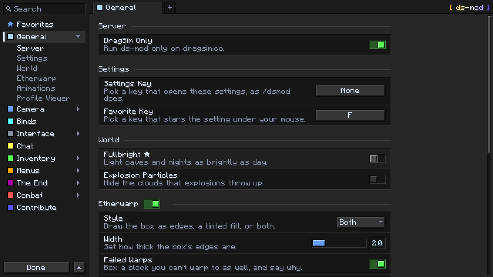

# Install Dragen

Dragen is a Fabric mod for the Dragon Simulator server, dragsim.co. It runs only on your client, and it's ready with no setup.

## What you need

- Minecraft 26.2 with Fabric Loader 0.20.1 or later.
- Java 25 or later.
- [Fabric API](https://modrinth.com/mod/fabric-api) and [Fabric Language Kotlin](https://modrinth.com/mod/fabric-language-kotlin).

## Install

1. Put `dragen-<version>.jar`, Fabric API and Fabric Language Kotlin in the `mods` folder of your game folder.
2. Start Minecraft with the Fabric profile.
3. Join dragsim.co.

Use the jar without `-debug` in its name. The debug jar is for developers, and you don't need it.

## Settings

Type `/dragen`, `/dg` or `/dragon` in chat to open the settings. Add words to search them, as in `/dragen zealot`. With Mod Menu, the config button beside Dragen opens them too. The settings open where you left them, and Dragen saves them in `config/dragen/config.json` in your game folder when you close them. If that file ever can't be read, Dragen starts from the defaults, keeps the old file beside it, and tells you its name in chat.

To open them with a key, pick one in **Settings Key** under General. It has no key at first, because DragSim Utils opens on Right Shift and one press would open both.

Point at a setting and click the star beside its name, or press F, to keep it in **Favorites**, the first section. F also stars the setting you moved to with the arrow keys. Pick another key, or a mouse button but left and right click, in **Favorite Key** under General. F types into the search while you are searching, and Ctrl+F still jumps to the search. Favorites starts empty and lists your starred settings in the order the sections do. Click a star again to take it out. A setting you unstar inside Favorites stays there with an empty star until you leave, so you can star it again if you slipped. A search looks through every section, so Favorites shows no matches while you search.

Dragen runs only while you play on dragsim.co. To use it anywhere, turn off [DragSim Only](features.md#dragsim-only) under General. On a Mac, Dragen keeps Ctrl and a left click a Ctrl click, as [Ctrl Click](features.md#ctrl-click) says.
